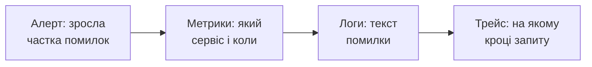
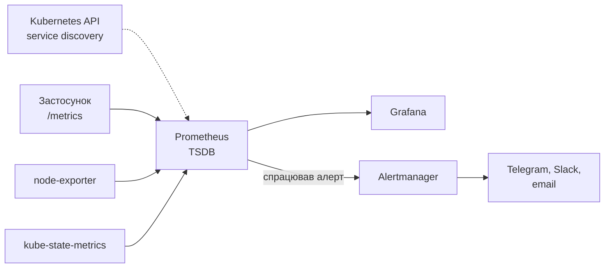
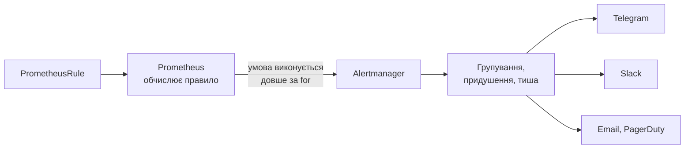
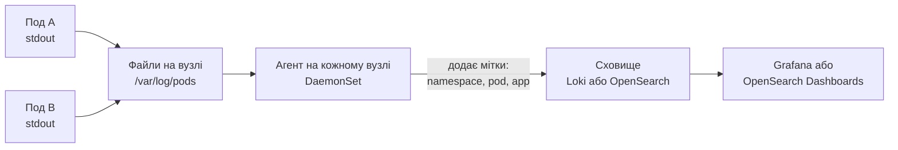
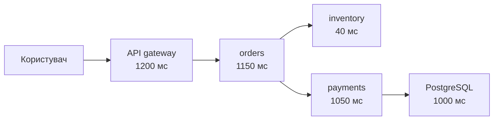
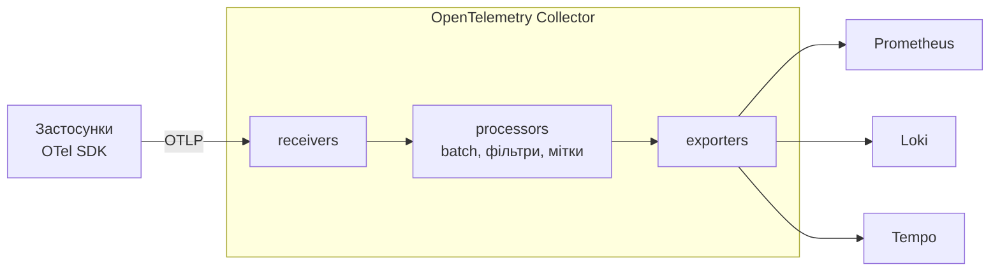

# Observability: метрики, логи, трейси

<small>Технології DevOps</small>

<style>
.reveal h1 { font-size: 1.7em; }
.reveal h2 { font-size: 1.2em; }
.reveal h3 { font-size: 0.95em; }
.reveal p, .reveal li { font-size: 0.62em; line-height: 1.4; }
.reveal blockquote { font-size: 0.7em; }
.reveal table { font-size: 0.58em; }
.reveal small { font-size: 0.5em; }
.reveal pre, .reveal code { font-size: 0.48em; }
.reveal ol, .reveal ul { display: inline-block; text-align: left; }

.reveal .mermaid,
.reveal .mermaid svg {
  width: 100% !important;
  height: auto !important;
  max-width: 1000px;
  max-height: 560px;
}
.reveal .mermaid { display: flex; justify-content: center; }
.reveal .mermaid .nodeLabel,
.reveal .mermaid text,
.reveal .mermaid tspan,
.reveal .mermaid .edgeLabel {
  fill: #1e293b !important;
  color: #1e293b !important;
}
.reveal .mermaid .node rect,
.reveal .mermaid .node polygon,
.reveal .mermaid .node circle {
  fill: #f4f1ea !important;
  stroke: #1e293b !important;
}
.reveal .mermaid .cluster rect {
  fill: #eef2ff !important;
  stroke: #94a3b8 !important;
}

.card-row { display: flex; gap: 1.2rem; justify-content: center; margin-top: 1rem; flex-wrap: wrap; }
.card { background: #f4f1ea; border-radius: 12px; padding: 0.8rem 1.2rem; font-size: 0.6em; text-align: left; flex: 1; min-width: 220px; max-width: 320px; }
.card b { font-size: 1.1em; }
.card.warn { background: #fef3c7; }
.card.ok { background: #dcfce7; }

.tree { background: #f4f1ea; border-radius: 12px; padding: 1rem 1.5rem; font-size: 0.5em; text-align: left; display: inline-block; font-family: monospace; line-height: 1.6; }

.callout { background: #fef3c7; border-left: 6px solid #d97706; border-radius: 8px; padding: 0.6rem 1rem; font-size: 0.6em; text-align: left; margin-top: 1rem; }
</style>

Note: Ця лекція продовжує Progressive delivery. Минулого разу ми написали AnalysisTemplate із запитом до Prometheus і домовилися, що реліз можна автоматично зупиняти за метриками. Але звідки ці метрики беруться, хто їх збирає й де зберігає, ми не обговорювали. Сьогодні закриваємо цю дірку і розширюємо тему: метрики, візуалізація, алерти, логи й трейси. Мета лекції: студенти мають розуміти, як побудувати систему, яка відповідає на питання «що зараз відбувається з моїм сервісом і чому».

---

## Де ми зупинилися

- Argo CD доставляє маніфести з Git, Argo Rollouts поступово викочує нову версію
- `AnalysisTemplate` питає Prometheus про частку помилок і вирішує, чи продовжувати реліз
- Але ми просто припустили, що Prometheus уже є і що застосунок віддає `http_requests_total`
<!-- .element: class="fragment" -->
- А ще: аналіз каже «реліз поганий», але не каже **чому**
<!-- .element: class="fragment" -->

--

### Питання, на які треба вміти відповідати

<div class="card-row">
<div class="card"><b>Чи все гаразд?</b><br>сервіс живий, відповідає швидко, не віддає помилок</div>
<div class="card"><b>Що саме зламалося?</b><br>який сервіс, який под, яка версія, з якого моменту</div>
<div class="card"><b>Чому?</b><br>який запит, яка помилка, на якому кроці обробки</div>
<div class="card"><b>Хто дізнається?</b><br>людина має отримати сигнал раніше, ніж користувачі почнуть скаржитися</div>
</div>

Note: Хороше запитання до аудиторії: як ви дізнаєтеся, що ваш курсовий проєкт, розгорнутий у кластері, впав о третій ночі? Чесна відповідь зазвичай: ніяк, або від викладача. Ось цю проблему ми сьогодні й вирішуємо.

---

## План заняття

1. Моніторинг та observability: три типи сигналів
2. Метрики та Prometheus
3. PromQL і що саме вимірювати
4. Візуалізація: Grafana
5. Алертинг
6. Збирання логів
7. Трейси та OpenTelemetry, практика

---

<!-- .slide: data-background-color="#eef2ff" -->

# Частина 1

## Моніторинг та observability

---

## Моніторинг і observability

<div class="card-row">
<div class="card"><b>Моніторинг</b><br>перевіряємо заздалегідь відомі речі: чи живий сервіс, чи не закінчується диск, чи не зросла частка помилок. Відповідає на питання, які ми вже придумали.</div>
<div class="card ok"><b>Observability</b><br>властивість системи: за її зовнішніми сигналами можна зрозуміти внутрішній стан, зокрема в ситуаціях, яких ніхто не передбачав. Дозволяє ставити нові питання без нового деплою.</div>
</div>

> Моніторинг каже, **що** зламалося. Observability допомагає зрозуміти **чому**.
<!-- .element: class="fragment" -->

Note: Термін прийшов з теорії керування: систему називають спостережуваною, якщо її внутрішній стан можна відновити за виходами. У світ розробки його популяризували приблизно з середини 2010-х, коли мікросервіси зробили класичний моніторинг недостатнім. Моніторинг не зникає: він є частиною observability. Просто дашборда з CPU вже мало, коли запит проходить через десять сервісів.

---

## Три типи сигналів

<div class="card-row">
<div class="card"><b>Метрики</b><br>числа в часі: кількість запитів, затримка, пам'ять. Дешеві, легко агрегуються, добре підходять для алертів і графіків.</div>
<div class="card"><b>Логи</b><br>події з деталями: що сталося, з якими параметрами, з яким текстом помилки. Дорогі в зберіганні, але найбільш детальні.</div>
<div class="card"><b>Трейси</b><br>шлях одного запиту через усі сервіси: де він провів скільки часу і де впав.</div>
</div>



Note: Ця схема — типовий сценарій розслідування інциденту. Метрики дешеві й показують, що щось не так. Логи дорожчі, але пояснюють деталі. Трейси зв'язують усе в один запит. Іноді до трьох сигналів додають четвертий — профілювання (continuous profiling), але для цього курсу достатньо трьох.

---

## Типовий стек

| Сигнал | Збирає | Зберігає | Показує |
|---|---|---|---|
| **Метрики** | Prometheus, exporters | Prometheus (або Thanos, Mimir, VictoriaMetrics для масштабу) | Grafana |
| **Логи** | Grafana Alloy, Fluent Bit, Vector | Loki або Elasticsearch / OpenSearch | Grafana або Kibana / OpenSearch Dashboards |
| **Трейси** | OpenTelemetry SDK і Collector | Tempo або Jaeger | Grafana або Jaeger UI |

Сьогодні беремо за основу відкритий стек **Prometheus + Grafana + Loki**, а для трейсів — **OpenTelemetry**
<!-- .element: class="fragment" -->

Note: Це не єдиний правильний вибір. Хмарні провайдери мають власні сервіси, є комерційні Datadog, New Relic, Dynatrace. Але Prometheus і Grafana — фактичний стандарт у світі Kubernetes, і ідеї, які ми сьогодні розберемо, переносяться на будь-який інший інструмент.

---

<!-- .slide: data-background-color="#eef2ff" -->

# Частина 2

## Метрики та Prometheus

---

## Що таке метрика

```text
http_requests_total{method="GET", path="/api/orders", status="200"}  1027
http_requests_total{method="GET", path="/api/orders", status="500"}  3
```

- **Назва** — що вимірюємо
- **Мітки (labels)** — у якому розрізі
- **Значення** — число в конкретний момент часу
- Кожна унікальна комбінація назви й міток — окремий **часовий ряд**
<!-- .element: class="fragment" -->

Note: Важливо одразу пояснити поняття часового ряду. Prometheus зберігає не «метрику», а окремі ряди для кожної комбінації міток. Тут два ряди. Якщо додати мітку з ідентифікатором користувача, рядів стане стільки, скільки користувачів. До цього повернемося в розмові про кардинальність.

---

## Prometheus

- Система моніторингу й база часових рядів, другий проєкт CNCF після Kubernetes
- **Pull-модель**: Prometheus сам періодично ходить до сервісів і забирає метрики з `/metrics`
- Знаходить цілі через **service discovery**, зокрема через Kubernetes API
<!-- .element: class="fragment" -->
- Має власну мову запитів **PromQL** і вміє обчислювати правила алертів
<!-- .element: class="fragment" -->

--

### Архітектура



Note: Стрілки від застосунку до Prometheus намальовані за напрямком даних, але ініціатор запиту — Prometheus. Кожні 15-30 секунд він робить HTTP GET на /metrics кожної цілі. Pull-модель має приємний побічний ефект: якщо ціль не відповідає, Prometheus це бачить одразу через спеціальну метрику up.

---

## Формат `/metrics`

```text
# HELP http_requests_total Total number of HTTP requests.
# TYPE http_requests_total counter
http_requests_total{method="GET",status="200"} 1027
http_requests_total{method="GET",status="500"} 3

# HELP process_resident_memory_bytes Resident memory size in bytes.
# TYPE process_resident_memory_bytes gauge
process_resident_memory_bytes 4.2391552e+07
```

Звичайний текст по HTTP: його можна відкрити в браузері або через `curl`

<div class="callout">Prometheus 3 уміє також приймати метрики у форматі OpenTelemetry (OTLP), тобто вже не тільки pull. Але класична модель scrape залишається основною.</div>

---

## Типи метрик

<div class="card-row">
<div class="card"><b>Counter</b><br>лише зростає (або скидається при рестарті). Кількість запитів, помилок, байтів. Сам по собі нецікавий, цікава швидкість зростання.</div>
<div class="card"><b>Gauge</b><br>може рости й падати. Пам'ять, кількість подів, довжина черги, температура.</div>
</div>
<div class="card-row">
<div class="card"><b>Histogram</b><br>розподіл значень по кошиках (buckets). Затримки, розміри відповідей. Дає змогу рахувати перцентилі на сервері.</div>
<div class="card"><b>Summary</b><br>перцентилі, пораховані на боці застосунку. Їх не можна коректно агрегувати між подами.</div>
</div>

Note: На практиці для затримок майже завжди використовують histogram, а не summary. Причина: summary рахує p95 окремо в кожному поді, а середнє з p95 п'яти подів не дорівнює p95 усього сервісу. Histogram передає кошики, і перцентиль рахується вже після складання всіх подів. Це гарне питання на розуміння.

---

## Звідки беруться метрики

<div class="card-row">
<div class="card"><b>Інструментування застосунку</b><br>бібліотека-клієнт у коді: Micrometer для Spring Boot, <code>prometheus_client</code> для Python, OpenTelemetry SDK</div>
<div class="card"><b>Exporters</b><br>окремий процес перекладає метрики чужої системи у формат Prometheus: node-exporter, postgres-exporter, redis-exporter, blackbox-exporter</div>
<div class="card"><b>Метрики Kubernetes</b><br>kube-state-metrics (стан об'єктів), cAdvisor у kubelet (ресурси контейнерів), метрики API-сервера</div>
</div>

--

### Інструментування на прикладі Python

```python
from prometheus_client import Counter, Histogram, start_http_server

REQUESTS = Counter("http_requests_total", "HTTP requests", ["method", "status"])
LATENCY = Histogram("http_request_duration_seconds", "Request latency")

@LATENCY.time()
def handle(request):
    ...
    REQUESTS.labels(method=request.method, status="200").inc()

start_http_server(8000)   # /metrics на порту 8000
```

<small>У Spring Boot достатньо додати Actuator і <code>micrometer-registry-prometheus</code>: з'явиться ендпоінт <code>/actuator/prometheus</code> з десятками готових метрик JVM і HTTP</small>

---

## Prometheus у Kubernetes

- Найпоширеніший спосіб — Helm-чарт **kube-prometheus-stack** від prometheus-community
- Встановлює одним релізом: Prometheus Operator, Prometheus, Alertmanager, Grafana, node-exporter, kube-state-metrics
- Плюс набір готових правил алертів і дашбордів для самого кластера
<!-- .element: class="fragment" -->

```bash
helm repo add prometheus-community https://prometheus-community.github.io/helm-charts
helm install kps prometheus-community/kube-prometheus-stack \
  --namespace monitoring --create-namespace
```

Note: Тут зручно згадати лекцію про Helm: ми тоді брали prometheus-community як приклад репозиторію. А після GitOps логічно ставити цей чарт не вручну, а як Application в Argo CD.

---

## Prometheus Operator і ServiceMonitor

Замість ручного редагування `prometheus.yml` цілі описують Kubernetes-ресурсами

```yaml
apiVersion: monitoring.coreos.com/v1
kind: ServiceMonitor
metadata:
  name: web
  labels:
    release: kps          # щоб Prometheus із kube-prometheus-stack його помітив
spec:
  selector:
    matchLabels:
      app: web            # який Service моніторити
  endpoints:
    - port: http          # іменований порт у Service
      path: /metrics
      interval: 30s
```

- `ServiceMonitor` — цілі через `Service`, `PodMonitor` — напряму через поди
- `PrometheusRule` — правила алертів, теж як Kubernetes-ресурс
<!-- .element: class="fragment" -->

--

### Чому це зручно

- Опис моніторингу лежить поруч із маніфестами застосунку, в тому самому Helm-чарті
- Argo CD доставляє його разом із застосунком
- Оператор сам перетворює `ServiceMonitor` на конфігурацію Prometheus і перезавантажує її

<div class="callout">Найчастіша проблема: створили <code>ServiceMonitor</code>, а метрики не з'являються. За замовчуванням kube-prometheus-stack бере лише ті, що мають мітку <code>release</code> з назвою Helm-релізу. Друга причина: порт у Service не має імені або назва не збігається.</div>

---

## Кардинальність

- Кожна комбінація міток — новий часовий ряд, а кожен ряд займає пам'ять
- `status` має кілька значень — нормально
- `user_id`, `request_id`, `email`, повний URL з параметрами — кількість рядів росте необмежено
<!-- .element: class="fragment" -->

| Мітки | Приблизна кількість рядів |
|---|---|
| `method` × `status` | 5 × 10 = 50 |
| + `path` (20 маршрутів) | 1 000 |
| + `pod` (10 подів) | 10 000 |
| + `user_id` (100 000 користувачів) | 1 000 000 000 |
<!-- .element: class="fragment" -->

Note: Це найчастіша причина, чому Prometheus з'їдає всю пам'ять і падає. Правило: у мітки кладемо лише значення з невеликим і передбачуваним набором. Конкретний користувач чи запит — це місце для логів і трейсів, а не для метрик.

---

<!-- .slide: data-background-color="#eef2ff" -->

# Частина 3

## PromQL і що вимірювати

---

## PromQL: базові запити

```promql
# усі ряди метрики
http_requests_total

# фільтр за мітками
http_requests_total{status=~"5..", namespace="shop"}

# швидкість зростання лічильника: запитів за секунду за останні 5 хвилин
rate(http_requests_total[5m])

# сума по всіх подах у розрізі статусу
sum by (status) (rate(http_requests_total[5m]))

# цілі, до яких Prometheus не може достукатися
up == 0
```

Note: Головне, що треба запам'ятати: з counter майже завжди використовують rate. Саме значення лічильника, наприклад 1 027 запитів, нічого не каже: невідомо, за який час і коли під перезапускався. rate враховує скидання лічильника і дає швидкість. Квадратні дужки задають вікно, за яке рахуємо швидкість.

---

## PromQL: частки й перцентилі

```promql
# частка помилок сервісу
sum(rate(http_requests_total{service="web", status=~"5.."}[5m]))
/
sum(rate(http_requests_total{service="web"}[5m]))

# 95-й перцентиль затримки з histogram
histogram_quantile(0.95,
  sum by (le) (rate(http_request_duration_seconds_bucket{service="web"}[5m])))

# пам'ять контейнерів у неймспейсі
sum by (pod) (container_memory_working_set_bytes{namespace="shop"})
```

Перший запит — майже точно той, що ми писали в `AnalysisTemplate` минулого разу
<!-- .element: class="fragment" -->

Note: Чому перцентилі, а не середнє: якщо 95 запитів відповіли за 50 мс, а 5 — за 10 секунд, середнє вийде близько пів секунди, і виглядатиме нормально. Але кожен двадцятий користувач чекає 10 секунд. p95 і p99 показують досвід найменш щасливих користувачів, і саме вони скаржаться.

---

## Що вимірювати: методики

<div class="card-row">
<div class="card"><b>Four golden signals</b><br>з книги Google SRE: <b>latency</b>, <b>traffic</b>, <b>errors</b>, <b>saturation</b>. Універсальний набір для будь-якого сервісу.</div>
<div class="card"><b>RED</b><br><b>Rate</b>, <b>Errors</b>, <b>Duration</b>. Для сервісів, що обробляють запити: API, веб-застосунки.</div>
<div class="card"><b>USE</b><br><b>Utilization</b>, <b>Saturation</b>, <b>Errors</b>. Для ресурсів: CPU, диск, мережа, черги, пули з'єднань.</div>
</div>

<div class="callout">Почніть з RED для кожного сервісу та USE для вузлів кластера. Цього вистачає, щоб помітити більшість проблем.</div>

Note: RED запропонував Том Вілкі, USE — Брендан Грегг. Вони не конкурують, а доповнюють одна одну: RED — погляд користувача на сервіс, USE — погляд на інфраструктуру під ним. Згадайте минулу лекцію: у callout ми радили для аналізу релізу два-три золоті сигнали.

---

## SLI, SLO та error budget

<div class="card-row">
<div class="card"><b>SLI</b><br>показник рівня сервісу: частка успішних запитів, частка запитів швидших за 300 мс</div>
<div class="card"><b>SLO</b><br>цільове значення: 99,5% успішних запитів за 30 днів</div>
<div class="card"><b>Error budget</b><br>допустимі 0,5% невдач. Поки бюджет є — можна релізити сміливо. Закінчився — пріоритет на стабільність.</div>
</div>

| SLO | Допустимий простій за 30 днів |
|---|---|
| 99% | ≈ 7 год 12 хв |
| 99,9% | ≈ 43 хв |
| 99,99% | ≈ 4 хв |
<!-- .element: class="fragment" -->

Note: SLA — це договір із клієнтом із наслідками, зазвичай грошовими. SLO — внутрішня ціль, яка має бути суворішою за SLA. Ідея error budget: 100% надійності не потрібно і дуже дорого. Якщо бюджет не витрачається, команда, можливо, надто обережна і релізить замало. Це пов'язує observability з DORA-метриками з першої лекції.

---

<!-- .slide: data-background-color="#eef2ff" -->

# Частина 4

## Візуалізація: Grafana

---

## Grafana

- Інструмент для дашбордів, який не зберігає дані сам, а читає їх із **джерел даних**
- Prometheus, Loki, Tempo, Elasticsearch, PostgreSQL, хмарні сервіси — усе в одному інтерфейсі
- Режим **Explore** для довільних запитів без створення дашборда
<!-- .element: class="fragment" -->
- Перехід від графіка до логів і трейсів того самого сервісу за той самий проміжок часу
<!-- .element: class="fragment" -->

--

### З чого складається дашборд

<div class="card-row">
<div class="card"><b>Панелі</b><br>графік часового ряду, одне число (stat), шкала (gauge), таблиця, heatmap для розподілів</div>
<div class="card"><b>Змінні</b><br>випадні списки вгорі: namespace, сервіс, под. Один дашборд для всіх сервісів</div>
<div class="card"><b>Діапазон часу</b><br>спільний для всіх панелей; виділення ділянки на графіку збільшує її</div>
<div class="card"><b>Анотації</b><br>вертикальні позначки подій: деплой, інцидент, зміна конфігурації</div>
</div>

Note: Анотації варто показати окремо: якщо позначати на графіках моменти релізів, одразу видно, після якого деплою все погіршилося. Це ще один зв'язок з попередніми лекціями.

---

## Хороший дашборд

<div class="card-row">
<div class="card ok"><b>Зверху — найважливіше</b><br>RED сервісу одним рядком: запити, помилки, p95. Відповідь на «все гаразд?» за 5 секунд</div>
<div class="card ok"><b>Далі — деталі</b><br>розбивка за подами, маршрутами, залежностями; ресурси (USE)</div>
<div class="card ok"><b>Одиниці й пороги</b><br>секунди, а не «0.312»; кольорові пороги, щоб погане значення було видно</div>
</div>
<div class="card-row">
<div class="card warn"><b>Сорок графіків на екрані</b><br>ніхто не знає, на що дивитися</div>
<div class="card warn"><b>Середні значення</b><br>ховають проблеми, які видно в перцентилях</div>
<div class="card warn"><b>Дашборд, створений мишкою</b><br>зник разом із подом Grafana, і ніхто не пам'ятає, як його відновити</div>
</div>

---

## Дашборди як код

- Дашборд у Grafana — це JSON, його можна експортувати й зберегти в Git
- У kube-prometheus-stack Grafana автоматично підхоплює `ConfigMap` з міткою `grafana_dashboard: "1"`
- Готові дашборди спільноти на grafana.com можна імпортувати за номером
<!-- .element: class="fragment" -->

```yaml
apiVersion: v1
kind: ConfigMap
metadata:
  name: web-dashboard
  labels:
    grafana_dashboard: "1"
data:
  web.json: |
    { "title": "Web service", "panels": [ ... ] }
```

Note: Тут знову GitOps: дашборд лежить у Helm-чарті застосунку, Argo CD доставляє ConfigMap, Grafana його підхоплює. Хто хоче писати дашборди не в JSON, а кодом, може подивитися на Grafonnet (Jsonnet) або Grafana Foundation SDK. Для курсу достатньо експорту JSON.

---

<!-- .slide: data-background-color="#eef2ff" -->

# Частина 5

## Алертинг

---

## Як працюють алерти



- **Prometheus** вирішує, що умова порушена
- **Alertmanager** вирішує, кому, як і чи взагалі повідомляти
<!-- .element: class="fragment" -->

---

## Правило алерту

```yaml
apiVersion: monitoring.coreos.com/v1
kind: PrometheusRule
metadata:
  name: web-alerts
  labels:
    release: kps
spec:
  groups:
    - name: web
      rules:
        - alert: WebHighErrorRate
          expr: |
            sum(rate(http_requests_total{service="web", status=~"5.."}[5m]))
            / sum(rate(http_requests_total{service="web"}[5m])) > 0.05
          for: 5m                      # умова має триматися 5 хвилин
          labels:
            severity: critical
          annotations:
            summary: "Сервіс web: більше 5% помилок"
            runbook_url: https://wiki.example.com/runbooks/web-errors
```

Note: Поле for захищає від одиничних сплесків: алерт спершу переходить у стан pending, і лише якщо умова триває 5 хвилин, стає firing. runbook_url — посилання на інструкцію, що робити. Людина, яку розбудили вночі, не повинна згадувати, як влаштований сервіс.

---

## Що вміє Alertmanager

<div class="card-row">
<div class="card"><b>Маршрутизація</b><br>за мітками: <code>severity=critical</code> — на чергового, <code>warning</code> — у робочий канал</div>
<div class="card"><b>Групування</b><br>впав вузол і 30 подів на ньому: одне повідомлення замість тридцяти</div>
<div class="card"><b>Придушення (inhibition)</b><br>якщо недоступний весь кластер, не надсилати алерти про кожен сервіс у ньому</div>
<div class="card"><b>Тиша (silence)</b><br>тимчасово вимкнути алерти на час планових робіт</div>
</div>

---

## Хороші алерти

<div class="card-row">
<div class="card ok"><b>На симптоми, а не на причини</b><br>«користувачі отримують помилки» важливіше за «CPU 90%». Високий CPU без впливу на користувачів не варто того, щоб будити людину</div>
<div class="card ok"><b>Кожен алерт вимагає дії</b><br>якщо на алерт ніхто нічого не робить, його треба видалити або перевести у warning</div>
<div class="card ok"><b>Зрозумілий текст</b><br>що зламалося, наскільки серйозно, де інструкція</div>
</div>

<div class="callout"><b>Alert fatigue</b>: коли алертів забагато і більшість хибні, люди перестають на них реагувати, і справжній інцидент тоне в шумі. Десять зайвих алертів гірші, ніж жодного.</div>

Note: Добре підходить історія з практики будь-якої команди: канал з алертами, на який усі вимкнули сповіщення. Це гірше, ніж відсутність моніторингу, бо створює ілюзію, що все під контролем. Корисне правило з SRE: алерти на сторінку чергового — лише на те, що впливає на SLO.

---

<!-- .slide: data-background-color="#eef2ff" -->

# Частина 6

## Збирання логів

---

## Логи в Kubernetes

- Застосунок у контейнері пише логи у **stdout / stderr**, а не у файли
- Container runtime зберігає їх на вузлі в `/var/log/pods/...`
- `kubectl logs` читає саме ці файли
<!-- .element: class="fragment" -->

<div class="card-row">
<div class="card warn"><b>Под видалили</b><br>його логи зникають разом із ним</div>
<div class="card warn"><b>Вузол замінили</b><br>зникають логи всіх подів на ньому</div>
<div class="card warn"><b>20 реплік</b><br>помилку треба шукати у двадцяти окремих потоках</div>
</div>

Потрібна централізована система: зібрати, зберегти, шукати
<!-- .element: class="fragment" -->

Note: Згадайте лекцію про Docker: принцип «одного процесу в контейнері» і логування в stdout із 12-factor app. Саме завдяки йому збирати логи в Kubernetes просто: усі вони лежать у передбачуваному місці на кожному вузлі.

---

## Архітектура збору логів



- Агент запускається як **DaemonSet** — по одному поду на вузол
- Він читає файли, додає метадані з Kubernetes API і відправляє далі
<!-- .element: class="fragment" -->

---

## Агенти для збору логів

<div class="card-row">
<div class="card"><b>Grafana Alloy</b><br>універсальний колектор від Grafana Labs на основі OpenTelemetry Collector: логи, метрики, трейси</div>
<div class="card"><b>Fluent Bit</b><br>легкий агент на C, проєкт CNCF; працює з будь-яким сховищем</div>
<div class="card"><b>Vector</b><br>агент і конвеєр обробки на Rust від Datadog</div>
<div class="card"><b>OpenTelemetry Collector</b><br>вендор-нейтральний варіант, про нього в наступній частині</div>
</div>

<div class="callout">У багатьох туторіалах для Loki досі використовують <b>Promtail</b>. Він досяг кінця підтримки 2 березня 2026 року; Grafana рекомендує переходити на Alloy, для цього є команда <code>alloy convert --source-format=promtail</code>.</div>

Note: Студенти неминуче натраплять на старі статті з Promtail і loki-stack. Варто прямо сказати, що це застарілий шлях. Ідеї ті самі, змінився лише агент.

---

## Loki чи Elasticsearch

| | Loki | Elasticsearch / OpenSearch |
|---|---|---|
| **Що індексує** | лише мітки (namespace, app, pod) | увесь текст повідомлення |
| **Вартість зберігання** | низька, чанки в об'єктному сховищі | висока, великі індекси |
| **Пошук по тексту** | перебір у межах вибраних міток | швидкий повнотекстовий |
| **Аналітика** | базова, через LogQL | потужна агрегація |
| **Інтерфейс** | Grafana, поруч із метриками | Kibana / OpenSearch Dashboards |

Loki задуманий як «Prometheus для логів»: ті самі мітки, той самий підхід
<!-- .element: class="fragment" -->

Note: Стек Elasticsearch + Logstash + Kibana відомий як ELK, з Fluentd замість Logstash — EFK. OpenSearch — форк Elasticsearch, який з'явився у 2021 році після зміни ліцензії Elasticsearch. Для невеликих команд і Kubernetes частіше обирають Loki, бо він дешевший і живе поруч із Prometheus у Grafana. Коли потрібен складний пошук і аналітика по тексту, обирають Elasticsearch чи OpenSearch.

---

## LogQL

```logql
# усі логи сервісу web у неймспейсі shop
{namespace="shop", app="web"}

# лише рядки з "error"
{namespace="shop", app="web"} |= "error"

# розібрати JSON і відфільтрувати за полем
{app="web"} | json | status >= 500 | line_format "{{.method}} {{.path}} {{.status}}"

# метрика з логів: кількість помилок за хвилину по подах
sum by (pod) (count_over_time({app="web"} |= "error" [1m]))
```

Note: Синтаксис селектора у фігурних дужках такий самий, як у PromQL. Це навмисно: мітки в Loki й Prometheus збігаються, тому Grafana може перейти з графіка метрик до логів того самого поду. Останній приклад показує, що з логів можна будувати графіки й навіть алерти, але для постійних показників краще мати нормальну метрику: вона дешевша.

---

## Структуровані логи

<div class="card-row">
<div class="card warn"><b>Текст</b><br><code>2026-10-15 11:02:13 ERROR Failed to create order 512 for user 77: timeout</code><br>Шукати можна, але розбирати — регулярними виразами</div>
<div class="card ok"><b>JSON</b><br><code>{"ts":"2026-10-15T11:02:13Z", "level":"error", "msg":"order creation failed", "order_id":512, "user_id":77, "error":"timeout", "trace_id":"4bf92f35..."}</code></div>
</div>

- Поля можна фільтрувати й агрегувати без парсингу
- `trace_id` у кожному рядку дає змогу перейти від лога до трейсу
<!-- .element: class="fragment" -->
- `user_id` у лозі — нормально; у мітках Loki — так само погано, як у Prometheus
<!-- .element: class="fragment" -->

Note: Для Java: Logback або Log4j2 з JSON-енкодером, для Spring Boot 3.4+ є вбудоване структуроване логування. Для Python: structlog або python-json-logger. І обов'язково: ніяких паролів, токенів і персональних даних у логах. Логи читає багато людей і зберігаються вони довго.

---

<!-- .slide: data-background-color="#eef2ff" -->

# Частина 7

## Трейси та OpenTelemetry

---

## Навіщо трейси



- **Trace** — увесь шлях одного запиту; **span** — один крок із часом початку і тривалістю
- Метрики кажуть «orders повільний», трейс показує, що насправді повільний запит до бази в payments
<!-- .element: class="fragment" -->

--

### Як трейс проходить між сервісами

- Перший сервіс генерує `trace_id`
- Він передається далі в HTTP-заголовку `traceparent` (стандарт W3C Trace Context)
- Кожен сервіс створює свої spans з тим самим `trace_id`
- Усі spans збираються в одне дерево в системі трейсингу

```text
traceparent: 00-4bf92f3577b34da6a3ce929d0e0e4736-00f067aa0ba902b7-01
```

Note: Ключова умова: кожен сервіс у ланцюжку має передавати заголовок далі. Якщо один сервіс його загубив, трейс розривається на два. Автоматичне інструментування бібліотек HTTP-клієнтів робить це саме.

---

## OpenTelemetry

- Проєкт CNCF: єдиний відкритий стандарт для метрик, логів і трейсів
- Складається з API, SDK для різних мов, протоколу **OTLP** та **Collector**
- Не є сховищем: дані відправляються в Prometheus, Loki, Tempo, Jaeger або комерційні системи
<!-- .element: class="fragment" -->
- Головна цінність: інструментуємо код один раз і не прив'язуємося до вендора
<!-- .element: class="fragment" -->

<div class="callout">Для Java є агент автоматичного інструментування: <code>java -javaagent:opentelemetry-javaagent.jar -jar app.jar</code>. Без змін коду він створює spans для HTTP, JDBC, Kafka та багатьох інших бібліотек.</div>

---

## OpenTelemetry Collector



```yaml
service:
  pipelines:
    traces:
      receivers: [otlp]
      processors: [batch]
      exporters: [otlp/tempo]
```

Note: Collector — посередник між застосунками й сховищами. Застосунок знає лише адресу Collector, а куди далі йдуть дані, вирішує конфігурація Collector. Змінити Tempo на Jaeger чи на хмарний сервіс можна без змін у коді. Alloy, про який ми говорили в частині про логи, побудований на основі OpenTelemetry Collector, тому може грати ту саму роль.

---

## Зв'язок сигналів

<div class="card-row">
<div class="card"><b>Метрика → трейс</b><br>exemplars: на графіку затримки є точки з <code>trace_id</code> конкретних повільних запитів</div>
<div class="card"><b>Лог → трейс</b><br><code>trace_id</code> у структурованому лозі, Grafana робить з нього посилання на трейс</div>
<div class="card"><b>Трейс → логи</b><br>з будь-якого span відкрити логи того самого поду за той самий час</div>
</div>

Саме цей зв'язок перетворює три окремі системи на observability
<!-- .element: class="fragment" -->

Note: Повернімося до схеми з початку лекції: алерт, метрики, логи, трейс. Без спільних міток і trace_id на кожному кроці треба вручну зіставляти час і назви подів. З ними це кілька кліків у Grafana.

---

<!-- .slide: data-background-color="#eef2ff" -->

# Практика

## minikube

---

## Хід практичної частини

1. Запустити minikube з запасом ресурсів: `minikube start --cpus 4 --memory 8192`
2. Встановити kube-prometheus-stack Helm-чартом у неймспейс `monitoring`
3. Відкрити Grafana через `kubectl port-forward` і переглянути готові дашборди кластера
4. Відкрити Prometheus, виконати кілька запитів: `up`, використання CPU і пам'яті подами
5. Розгорнути застосунок з `/metrics`, додати `ServiceMonitor`, знайти його у Targets
6. Встановити Loki і Alloy, додати Loki як джерело даних, знайти логи застосунку в Explore
7. Створити простий дашборд RED і правило алерту, спричинити помилки й дочекатися алерту

--

### Команди

```bash
# Grafana
kubectl -n monitoring port-forward svc/kps-grafana 3000:80
kubectl -n monitoring get secret kps-grafana \
  -o jsonpath="{.data.admin-password}" | base64 -d; echo

# Prometheus і Alertmanager
kubectl -n monitoring port-forward svc/kps-kube-prometheus-stack-prometheus 9090
kubectl -n monitoring port-forward svc/kps-kube-prometheus-stack-alertmanager 9093
```

<small>Точні назви сервісів залежать від назви релізу: перевірити через <code>kubectl -n monitoring get svc</code></small>

Note: Перед заняттям обов'язково прогнати ці кроки на своїй машині. kube-prometheus-stack разом із Loki на minikube потребує щонайменше 6-8 ГБ пам'яті. На слабких ноутбуках студентів варто вимкнути частину компонентів через values або робити практику парами.

---

## Loki й Alloy для практики

Loki в режимі одного процесу з файловим сховищем (`loki-values.yaml`):

```yaml
deploymentMode: SingleBinary
loki:
  auth_enabled: false
  commonConfig:
    replication_factor: 1
  storage:
    type: filesystem
  schemaConfig:
    configs:
      - from: "2024-01-01"
        store: tsdb
        object_store: filesystem
        schema: v13
        index: {prefix: index_, period: 24h}
singleBinary: {replicas: 1}
read: {replicas: 0}
write: {replicas: 0}
backend: {replicas: 0}
chunksCache: {enabled: false}
resultsCache: {enabled: false}
```

<small>Розміщення Helm-чарту Loki змінювалося в 2026 році: перед заняттям звірити з документацією, з якого репозиторію його ставити</small>

--

### Конфігурація Alloy

```alloy
discovery.kubernetes "pods" {
  role = "pod"
}

discovery.relabel "pods" {
  targets = discovery.kubernetes.pods.targets
  rule {
    source_labels = ["__meta_kubernetes_namespace"]
    target_label  = "namespace"
  }
  rule {
    source_labels = ["__meta_kubernetes_pod_name"]
    target_label  = "pod"
  }
  rule {
    source_labels = ["__meta_kubernetes_pod_label_app"]
    target_label  = "app"
  }
}

loki.source.kubernetes "pods" {
  targets    = discovery.relabel.pods.output
  forward_to = [loki.write.default.receiver]
}

loki.write "default" {
  endpoint {
    url = "http://loki-gateway.monitoring/loki/api/v1/push"
  }
}
```

Note: Читати конфігурацію Alloy слід як конвеєр: знайти поди через Kubernetes API, переписати службові мітки в зрозумілі, читати логи цих подів, відправити в Loki. loki.source.kubernetes читає логи через API, а не з файлів на вузлі. Для практики це простіше, у продакшені частіше читають файли агентом-DaemonSet. Адреса gateway залежить від назви релізу Loki.

---

### Вправи

- **Вправа 1.** Побудувати в Grafana панель із часткою помилок і p95 затримки свого застосунку
- **Вправа 2.** Додати змінну `namespace` у дашборд і зробити, щоб панелі від неї залежали
- **Вправа 3.** Написати `PrometheusRule`, який спрацьовує, коли под застосунку недоступний довше 1 хвилини; вимкнути под і побачити алерт в Alertmanager
- **Вправа 4.** Переписати логування застосунку у JSON і знайти в Loki всі запити зі статусом 500
- **Вправа 5\*.** Підключити `AnalysisTemplate` з минулої лекції до свого Prometheus і зробити «поганий» реліз

Note: П'ята вправа замикає два заняття: тепер Prometheus справжній, метрики справжні, і Argo Rollouts може відкотити реліз за ними. Якщо на занятті мало часу, вправи 1-3 обов'язкові, 4 і 5 — для бажаючих.

---

## Типові помилки

<div class="card-row">
<div class="card warn"><b>Висока кардинальність</b><br><code>user_id</code>, URL з параметрами чи <code>request_id</code> у мітках; Prometheus з'їдає пам'ять</div>
<div class="card warn"><b>Середні замість перцентилів</b><br>графік рівний, а частина користувачів чекає по 10 секунд</div>
<div class="card warn"><b>Шумні алерти</b><br>на CPU і кожну дрібницю; на справжній інцидент уже ніхто не реагує</div>
<div class="card warn"><b>Логи у файл усередині контейнера</b><br>агент їх не бачить, а після рестарту вони зникають</div>
</div>
<div class="card-row">
<div class="card warn"><b>Секрети в логах</b><br>токени, паролі й персональні дані потрапляють у сховище, яке читає пів компанії</div>
<div class="card warn"><b>Дашборди тільки в UI</b><br>не лежать у Git і зникають разом з Grafana</div>
<div class="card warn"><b>Моніторинг усередині того, що моніториться</b><br>впав кластер — разом із ним упав і Prometheus, і ніхто не отримав алерт</div>
</div>

Note: Остання картка — гарне питання для обговорення. Як дізнатися, що мертвий сам моніторинг? Типові рішення: окремий кластер або хмарний сервіс для моніторингу, а також «dead man's switch» — алерт, який спрацьовує завжди, і зовнішня система тривожиться, якщо він перестав надходити. У kube-prometheus-stack такий алерт є, він називається Watchdog.

---

## Підсумки

- Observability: за зовнішніми сигналами розуміти, що відбувається всередині системи
- Три сигнали: **метрики** показують, що щось не так, **логи** — деталі, **трейси** — шлях запиту
- Prometheus збирає метрики pull-моделлю; у Kubernetes ціль описують через `ServiceMonitor`
- PromQL: `rate` для лічильників, перцентилі з histogram, мітки з малою кардинальністю
- Що вимірювати: golden signals, RED для сервісів, USE для ресурсів, SLO і error budget
- Grafana об'єднує всі джерела; дашборди зберігаються в Git
- Алерти — на симптоми й лише ті, що вимагають дії
- Логи — у stdout, у JSON, збираються агентом (Alloy, Fluent Bit) у Loki або OpenSearch
- OpenTelemetry — єдиний стандарт для інструментування; `trace_id` зв'язує всі сигнали

--

### Що далі

<div class="card-row">
<div class="card"><b>Безпека в Kubernetes</b><br>RBAC, політики (Kyverno, OPA Gatekeeper), керування секретами</div>
<div class="card"><b>Інфраструктура як код</b><br>як з'являється сам кластер, у якому все це працює</div>
</div>

---

## Питання для закріплення

1. Чим observability відрізняється від моніторингу? Які три типи сигналів ви знаєте і для чого кожен?
2. Чому для лічильників використовують `rate`, а для затримок — перцентилі, а не середнє?
3. Що таке кардинальність і чому `user_id` не можна робити міткою метрики?
4. Що таке SLO та error budget? Як error budget впливає на рішення про релізи?
5. Як логи з контейнера потрапляють у Loki? Чим Loki відрізняється від Elasticsearch?
6. Як `trace_id` допомагає перейти від алерту до конкретного запиту, що впав?

---

# Дякую за увагу

<small>prometheus.io · grafana.com/docs · opentelemetry.io · sre.google/books</small>
